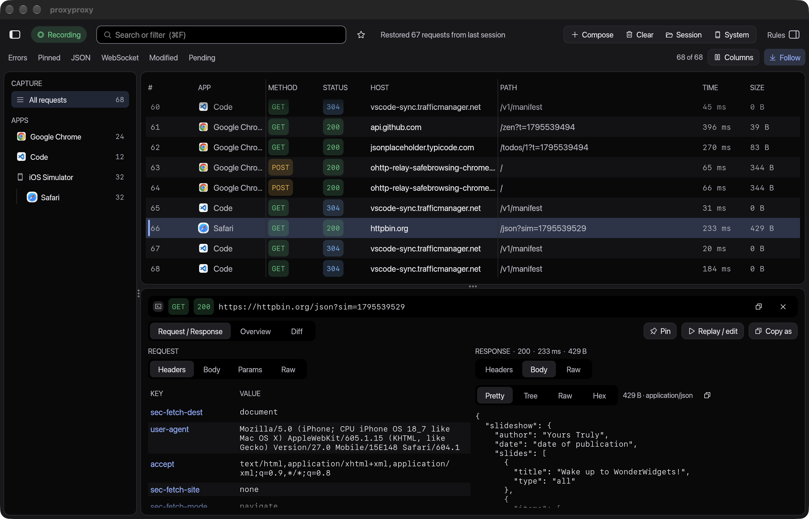
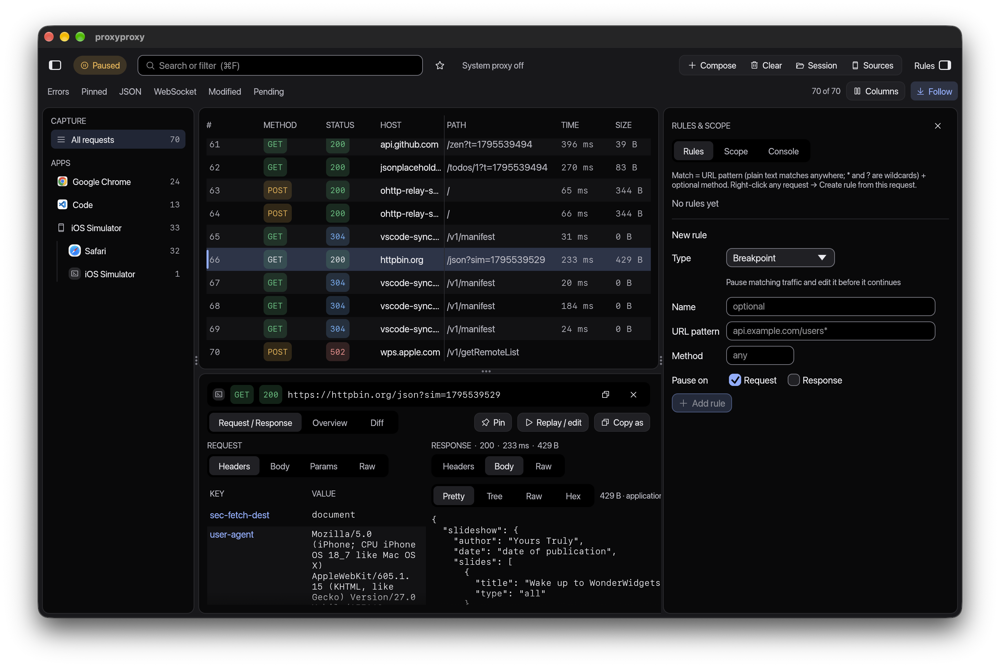

<p align="center"></p>

# proxyproxy

A desktop HTTP(S) debugging proxy written in Rust, similar to Proxyman and Charles. It decrypts TLS with a local CA, shows traffic in an egui window, and can rewrite, mock, pause and replay requests.





## Run

```sh
cargo run --release            # proxy on 127.0.0.1:9090, REST API on :9091
cargo run --release -- 8080    # custom port (API on port + 1)
```

Point a client at the proxy, or wrap a command:

```sh
proxyproxy run [--port N] -- curl https://example.com
```

`run` sets the `*_PROXY` variables and the usual CA-bundle variables (`SSL_CERT_FILE`, `NODE_EXTRA_CA_CERTS`, `REQUESTS_CA_BUNDLE`, and others), then execs the command.

The Connect menu can trust the CA on this machine, set or clear the system proxy, launch Chrome with a clean profile, and set up the iOS Simulator and Android (adb).

The CA and config are in your user data directory under `proxyproxy/` (`ca.pem`, `ca.key`, `config.json`).

## Features

- Capture HTTP/1.1, HTTP/2 and WebSocket frames, with the client app shown per request (via `lsof`). Sessions autosave and can be saved or opened as `.pxp`.
- Search with queries like `host:api.* status:>=400 method:POST body:"userId"`. Filter chips and saved queries are included.
- Rules: breakpoints, map local (serve your own file, or a copy proxyproxy keeps in its data folder; switching is staged until you save the rule, never loses content and asks before overwriting a file that differs), redirect, block, throttle, header and body rewrite, mock responses, and JavaScript (`onRequest` / `onResponse`).
- Edit and resend requests, diff two requests, copy as cURL, fetch, Python, HTTPie or raw HTTP.
- Body views: pretty, tree, raw, hex, form, decoded protobuf.
  - Protobuf: load `FileDescriptorSet` files in the Schemas tab of Settings (⌘,). Bodies, including gRPC framing, are decoded with field names.
  - GraphQL: operation name and type, formatted query, variables, response data and errors.
- DNS overrides: map hosts (globs allowed) to IPs.
- Upstream proxy: a manual HTTP or SOCKS5 proxy, or a PAC file.
- Custom CA: import your own certificate and key, then restart.
- TLS key log in NSS format for Wireshark. `proxyproxy run` also honours `SSLKEYLOGFILE`.
- Mock sets: right-click a request → Mock response → New collection… turns its captured response into a Mock rule in a new folder (named after the host), or into an existing collection. "Mock all N visible responses" does the same for everything the filter shows, keeping the latest response per URL. Each collection has an on/off switch, so when the backend is down one click turns a whole scenario on, and "Use only this collection" switches scenarios. Rules JSON keeps collections; older rule files still import.
- Export HAR, CSV and rules JSON. Import HAR and Charles JSON sessions (`.chlsj`).
- REST API: `http://127.0.0.1:<port+1>/flows?q=&limit=`, `/flows/{id}`, `/har`.
- MCP (off by default; turn it on in Settings → MCP, otherwise `POST /mcp` answers 403). Any program on this computer can connect while it is on, and captured flows may contain secrets such as tokens and passwords. HTTP JSON-RPC at `http://127.0.0.1:<port+1>/mcp` (`Content-Type: application/json`; requests from web pages are refused), or stdio with `proxyproxy mcp --port 9090`. Settings → MCP → Connect a client shows a ready-to-copy setup per client: a pasteable `mcp.json` (Custom, for any client with an `mcpServers` config such as Antigravity or Cursor) or the add command for Claude Code, Codex and Gemini CLI.
  - Resources: captured traffic and individual flows.
  - Tools: list/get flows, replay requests, list/add/delete rules, list collections and turn them on or off, and export HAR.

## WIP

- DNS overrides and upstream proxy support for passthrough CONNECT and WebSocket traffic.

## Notes

- Rule edits apply to the next request. "Don't decrypt TLS" is checked when a connection opens, so it only affects new connections.
- Mute and scope hide traffic from the record, not the network. Muted and out-of-scope requests are still forwarded; they aren't shown or saved.
- DNS overrides and the upstream proxy apply to intercepted HTTP(S) requests. Passthrough tunnels (hosts with decryption off) and WebSocket upstream connections use the system resolver and connect directly.
- Charles: only the JSON session export imports. The binary `.chls` format isn't supported. In Charles, use File > Export Session… > JSON Session File.

## Development

```sh
cargo build
cargo test
cargo clippy --all-targets -- -D warnings
```

See [docs/ARCHITECTURE.md](docs/ARCHITECTURE.md) and [docs/CONTRIBUTING.md](docs/CONTRIBUTING.md).
